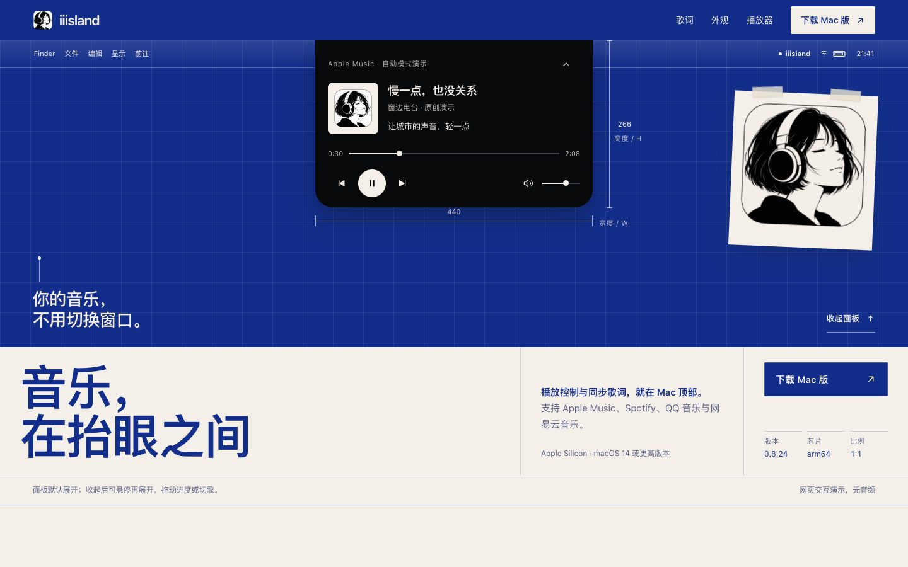

<p align="center"></p>
<h1 align="center">iiisland</h1>
<p align="center">Your music, a glance away.<br>Playback controls and synced lyrics at the top of your Mac.</p>
<p align="center"><a href="README.md">简体中文</a> · <strong>English</strong></p>
<p align="center"><a href="https://iiisland.pages.dev">Website</a> · <a href="https://github.com/zplzmzmpl/iiisland-pub/releases/latest">Download for Mac</a> · <a href="https://github.com/zplzmzmpl/iiisland-pub/issues">Report an issue</a></p>



*The image shows an interactive website illustration with original demo songs and lyrics. It is not a screenshot of a connected music player.*

[Try the website](https://iiisland.pages.dev): expand or collapse the island, switch tracks, adjust progress and volume, choose the capsule's text color, adjust transparency on desktop and hover the lyric to see it hide, and choose a player to see its supported features. An automatically looping size animation shows that collapsed and expanded width and height can be adjusted in the app, with no controls to operate. Desktop visitors can use playback and transparency controls; phones retain capsule text-color choices. The website does not play audio.

## Keep your music within reach

See the cover, check a lyric, or skip a track without switching windows. iiisland keeps your music at the top of the screen, compact while you work and ready to expand on hover or click.

- **Follow what is playing.** Works with Apple Music, Spotify, QQ Music and NetEase Cloud Music. Automatically follows the player that most recently started playback, or stays with a player you choose.
- **One lyric, two places.** Lyrics sit beside the collapsed island and move into the expanded panel. All four automatic capsule hiding options default to off and can be enabled individually. In-island lyrics default to on and follow the island switch, with a separate setting available.
- **Fine-tune lyric timing.** Enter an offset, adjust it in 100 ms steps or reset it under Lyrics → Time Sync, within the same Settings window.
- **Fit your screen.** Size the collapsed and expanded island separately and adjust the notch clearance above the expanded controls.
- **Choose your look.** Use classic black or native Liquid Glass on macOS 26. Switch between day and night modes, with your choice remembered.
- **Launch with your player.** Enable the option to open iiisland when a supported music player starts.

## Player support

| Player | Track, artwork and lyrics | Playback, skipping and seeking | Volume, shuffle and repeat |
| --- | --- | --- | --- |
| Apple Music | Supported | Supported | Supported |
| Spotify | Supported | Supported | Supported |
| QQ Music | Supported | Depends on system media focus and available capabilities | Not yet supported |
| NetEase Cloud Music | Supported | Depends on system media focus and available capabilities | Not yet supported |

Lyrics use online services, available embedded lyrics and a local cache. Availability and sync accuracy vary by track and provider. Start a song in QQ Music or NetEase Cloud Music before connecting for the first time.

An optional setting under Player connects browsers, video players and other apps that publish a macOS media session. It is off by default. Playing music takes priority; other media does not request lyrics, and available controls depend on the source and macOS version.

## Download and install

**Version 0.8.29 (build 38)** was released on **November 11, 2026**.

Requires an **Apple Silicon (arm64) Mac running macOS 14 or later**. An Intel installer is not currently available. Native Liquid Glass requires macOS 26.

1. Download `iiisland-0.8.29-arm64.dmg` from [Releases](https://github.com/zplzmzmpl/iiisland-pub/releases/latest).
2. Open the DMG and drag `iiisland.app` into the adjacent `Applications` folder.
3. Launch iiisland from Applications and play a song in your music player.

In 0.8.28 or later, click **Check for Updates** beside the version number in Settings, then install and relaunch. For older versions, quit iiisland and replace it with the app from the DMG.

**First launch:** The installer uses an ad-hoc local signature and has not been Developer ID signed or notarized by Apple. macOS may block the first launch. Apple Music or Spotify may request Automation permission on first connection. Reading media information from QQ Music and NetEase Cloud Music does not require Accessibility or Screen Recording permission.

### Verify the download

Download both the DMG and its matching `.sha256` file, then run this in the download directory:

```sh
shasum -a 256 -c iiisland-0.8.29-arm64.dmg.sha256
```

SHA-256 for this installer:

```text
b19c0ab30ede15428ab3c63e8d69be33e28b4916462bcc781204d221b593d739
```

## What’s new in 0.8.29

- The collapsed island fades in after the screen wakes and unlocks. With Reduce Motion enabled, it appears without a fade.
- Shorter Settings tooltips and no inline descriptions for the two lyrics retrieval controls.
- An optional Musixmatch user token in Lyrics settings, blank by default.

See the [0.8.29 release notes](https://github.com/zplzmzmpl/iiisland-pub/releases/tag/v0.8.29). Earlier releases are listed on [GitHub Releases](https://github.com/zplzmzmpl/iiisland-pub/releases).

## Feedback and acknowledgements

Use [Issues](https://github.com/zplzmzmpl/iiisland-pub/issues) to report problems. Include your macOS, iiisland and player versions, reproduction steps and relevant screenshots. Hide personal information before sharing screenshots.

Built on work from [boring.notch](https://github.com/TheBoredTeam/boring.notch), [LyricsX](https://github.com/MxIris-LyricsX-Project/LyricsX) and related open-source projects. See [third-party notices](NOTICE.md) for component origins and licenses.

This repository contains product information, usage documentation, issue tracking, downloadable releases and the website source. The macOS application source is not included. Third-party rights and license terms continue to apply.

## Website source and automatic deployment

The website source lives in [website/](website/) and uses plain HTML, CSS and JavaScript. Cloudflare Pages connects to this repository's `main` branch with `website` as the build output directory and no build command. Pushing website changes triggers an automatic deployment. See the [website maintenance guide](website/README.md) for configuration details.
