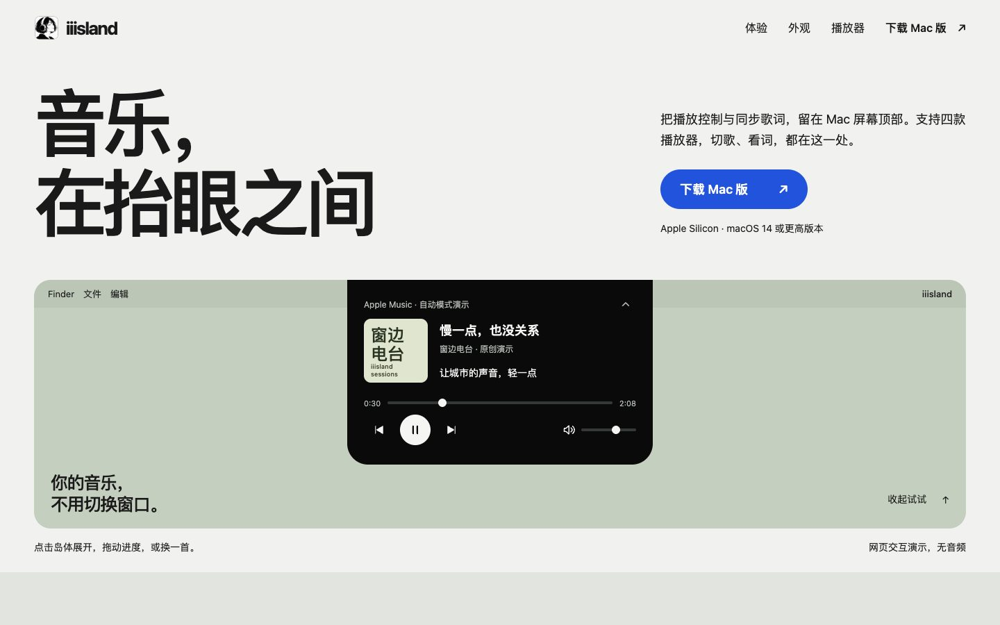

<p align="center"></p>
<h1 align="center">iiisland</h1>
<p align="center">音乐，在抬眼之间。<br>把播放控制与同步歌词，留在 Mac 屏幕顶部。</p>
<p align="center"><strong>简体中文</strong> · <a href="README.en.md">English</a></p>
<p align="center"><a href="https://iiisland.pages.dev">访问官网</a> · <a href="https://github.com/zplzmzmpl/iiisland-pub/releases/latest">下载 Mac 版</a> · <a href="https://github.com/zplzmzmpl/iiisland-pub/issues">反馈问题</a></p>



*画面为网页交互示意，歌曲与歌词均为原创演示内容，不是真实播放器截图。*

[在官网试用](https://iiisland.pages.dev)：展开与收起、切歌、调节进度与音量、点选歌词跳转，以及外观、尺寸和日夜预览；还可切换播放器查看支持能力。手机与电脑均可操作，网页演示不播放音频。

## 抬眼看歌词，伸手控音乐

不用来回切换播放器。iiisland 将封面、歌曲信息、播放控制和歌词放在屏幕顶部：收起时轻巧陪伴，悬停或点击即可展开。

- **跟上你正在听的。** 支持 Apple Music、Spotify、QQ 音乐与网易云音乐；自动跟随最近开始播放的来源，也可固定常用播放器。
- **一句歌词，两种位置。** 收起时，歌词贴在灵动岛左侧；展开时，回到播放面板。可独立开关菜单栏与岛内歌词，也可在暂停时保留最后一句。
- **适合你的屏幕。** 分别调整收起与展开的宽高，支持有刘海与无刘海屏幕布局。
- **两种外观。** 经典黑融入屏幕顶部；macOS 26 上可选择原生液态玻璃。日间与夜间模式可以手动切换并记忆。
- **随播放器启动。** 开启后，启动支持的播放器即可打开 iiisland。

## 播放器支持

| 播放器 | 歌曲、封面与歌词 | 播放、切歌与进度 | 音量、随机与循环 |
| --- | --- | --- | --- |
| Apple Music | 支持 | 支持 | 支持 |
| Spotify | 支持 | 支持 | 支持 |
| QQ 音乐 | 支持 | 取决于系统媒体焦点与可用能力 | 暂不支持 |
| 网易云音乐 | 支持 | 取决于系统媒体焦点与可用能力 | 暂不支持 |

歌词来自在线服务、可用的内嵌歌词与本地缓存；是否能取得歌词及同步精度取决于歌曲和来源。QQ 音乐与网易云音乐首次使用时，请先在播放器中播放歌曲。

## 下载与安装

当前版本：**0.8.16 · build 25**，安装包更新于 **2026-10-20**。

要求 **Apple Silicon（arm64）Mac、macOS 14 或更高版本**。当前不提供 Intel 安装包；原生液态玻璃需要 macOS 26。

1. 在 [Releases](https://github.com/zplzmzmpl/iiisland-pub/releases/latest) 下载 `iiisland-0.8.16-arm64.dmg`。
2. 打开 DMG，将 `iiisland.app` 拖入旁边的 `Applications` 文件夹。
3. 从“应用程序”启动 iiisland，并在音乐播放器中播放一首歌。

更新时，先退出旧版本，再替换应用。

**首次打开：** 当前安装包使用 ad-hoc 本地签名，未经 Developer ID 签名或 Apple 公证，macOS 可能阻止首次打开。首次连接 Apple Music 或 Spotify 时，系统可能请求自动化授权；QQ 音乐与网易云音乐的媒体读取不需要辅助功能或屏幕录制权限。

### 校验安装包

同时下载 DMG 与同名 `.sha256` 文件，在下载目录运行：

```sh
shasum -a 256 -c iiisland-0.8.16-arm64.dmg.sha256
```

本次安装包 SHA-256：

```text
ad0afa649a5d2d7c3f97ddac8c9823e5ae9f25385dd77298b7d8e68231ce56b7
```

## 0.8.16 有什么更新

- 修复长歌词滚动时右侧提前截断、留下空白的问题，让中段文字连续显示、句尾完整停留。
- 改善快速切句时的歌词胶囊过渡与灵动岛圆角。
- 新增四款播放器的自动检测与启动联动。
- 设置页采用适配日夜模式的手写风格字标。

详见 [版本发布说明](https://github.com/zplzmzmpl/iiisland-pub/releases/tag/v0.8.16)。

## 反馈与致谢

请通过 [Issues](https://github.com/zplzmzmpl/iiisland-pub/issues) 提交问题，附上 macOS、iiisland 与播放器版本、复现步骤及必要截图。截图前请遮盖个人信息。

感谢 [boring.notch](https://github.com/TheBoredTeam/boring.notch)、[LyricsX](https://github.com/MxIris-LyricsX-Project/LyricsX) 及相关开源项目。组件来源与许可证见 [第三方致谢](NOTICE.md)。

本仓库用于产品介绍、使用说明、问题反馈及安装包发布，不包含应用源码。第三方组件的权利与许可证继续适用。
