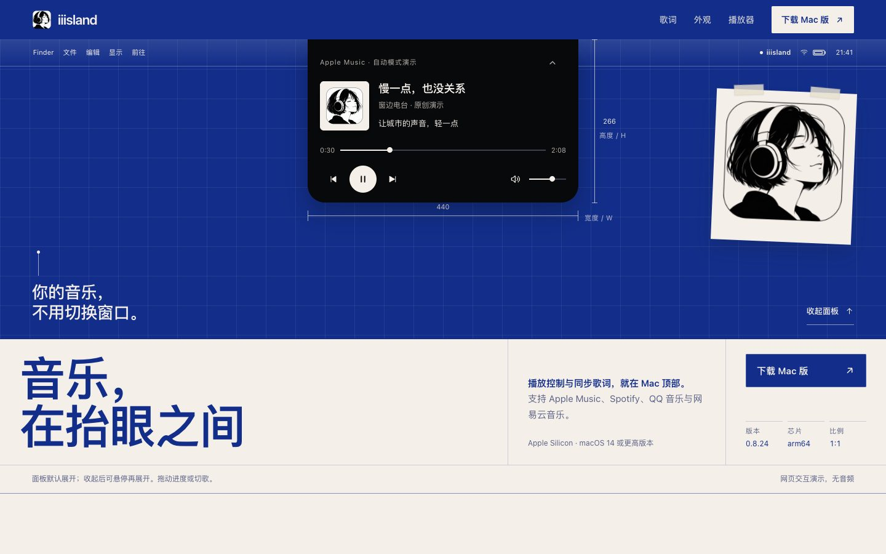

<p align="center"></p>
<h1 align="center">iiisland</h1>
<p align="center">音乐，在抬眼之间。<br>把播放控制与同步歌词，留在 Mac 屏幕顶部。</p>
<p align="center"><strong>简体中文</strong> · <a href="README.en.md">English</a></p>
<p align="center"><a href="https://iiisland.pages.dev">访问官网</a> · <a href="https://github.com/zplzmzmpl/iiisland-pub/releases/latest">下载 Mac 版</a> · <a href="https://github.com/zplzmzmpl/iiisland-pub/issues">反馈问题</a></p>



*画面为网页交互示意，歌曲与歌词均为原创演示内容，不是真实播放器截图。*

[在官网试用](https://iiisland.pages.dev)：展开与收起、切歌、调节进度与音量；还可切换播放器查看支持能力，在胶囊歌词区选择字体颜色、拖动或输入透明度，并悬停歌词体验自动隐身。尺寸展示以自动循环动效说明收起与展开的宽高可自由调整，无需操作。电脑可操作播放演示和透明度，手机可选择胶囊字体；网页不播放音频。

## 抬眼看歌词，伸手控音乐

不用来回切换播放器。iiisland 将封面、歌曲信息、播放控制和歌词放在屏幕顶部：收起时轻巧陪伴，悬停或点击即可展开。

- **跟上你正在听的。** 支持 Apple Music、Spotify、QQ 音乐与网易云音乐；自动跟随最近开始播放的来源，也可固定常用播放器。
- **一句歌词，两种位置。** 收起时，歌词贴在灵动岛左侧；展开时，回到播放面板。四项胶囊自动隐藏默认关闭，可按需开启；岛内歌词默认开启，随灵动岛开关同步切换，仍可单独调整。
- **自己校准歌词。** 在「歌词 → 时间同步」输入数值、按 100 毫秒微调或重置，统一在设置窗口内完成。
- **适合你的屏幕。** 分别调整收起和展开的宽高，并自定义展开内容的刘海预留高度。
- **两种外观。** 经典黑融入屏幕顶部；macOS 26 上可选择原生液态玻璃。日间与夜间模式可以手动切换并记忆。
- **随播放器启动。** 开启后，启动支持的播放器即可打开 iiisland。

## 播放器支持

| 播放器 | 歌曲、封面与歌词 | 播放、切歌与进度 | 音量、随机与循环 |
| --- | --- | --- | --- |
| Apple Music | 支持 | 支持 | 支持 |
| Spotify | 支持 | 支持 | 支持 |
| QQ 音乐 | 支持 | 取决于系统媒体焦点与可用能力 | 暂不支持 |
| 网易云音乐 | 支持 | 取决于系统媒体焦点与可用能力 | 暂不支持 |

歌词来自在线服务、可用的内嵌歌词与本地缓存；是否能取得歌词及同步精度取决于歌曲和来源。QQ 音乐与网易云音乐首次使用时，请先在播放器中播放歌曲。

也可在「播放器 → 接入其他媒体应用」中开启浏览器、视频播放器等系统媒体来源，默认关闭。应用或网页需发布系统媒体会话；播放中的音乐优先，其他媒体不查询歌词，控制能力随来源与系统版本而异。

## 下载与安装

当前版本为 **0.8.29（构建 38）**，发布于 **2026-11-11**。

要求 **Apple Silicon（arm64）Mac、macOS 14 或更高版本**。当前不提供 Intel 安装包；原生液态玻璃需要 macOS 26。

1. 在 [Releases](https://github.com/zplzmzmpl/iiisland-pub/releases/latest) 下载 `iiisland-0.8.29-arm64.dmg`。
2. 打开 DMG，将 `iiisland.app` 拖入旁边的 `Applications` 文件夹。
3. 从“应用程序”启动 iiisland，并在音乐播放器中播放一首歌。

从 0.8.28 起，可在设置页版本号旁点击「检查更新」，下载后安装并重启。更早版本请先退出 iiisland，再用 DMG 中的应用替换。

**首次打开：** 当前安装包使用 ad-hoc 本地签名，未经 Developer ID 签名或 Apple 公证，macOS 可能阻止首次打开。首次连接 Apple Music 或 Spotify 时，系统可能请求自动化授权；QQ 音乐与网易云音乐的媒体读取不需要辅助功能或屏幕录制权限。

### 校验安装包

同时下载 DMG 与同名 `.sha256` 文件，在下载目录运行：

```sh
shasum -a 256 -c iiisland-0.8.29-arm64.dmg.sha256
```

本次安装包 SHA-256：

```text
b19c0ab30ede15428ab3c63e8d69be33e28b4916462bcc781204d221b593d739
```

## 0.8.29 有什么更新

- 解锁且屏幕唤醒后，收起态灵动岛在原位淡入。开启「减少动态效果」时直接显示。
- 精简设置页提示，移除「获取歌词」两项的行内说明。
- 「设置 → 歌词」支持选填 Musixmatch 用户 token，默认留空。

详见 [0.8.29 发布说明](https://github.com/zplzmzmpl/iiisland-pub/releases/tag/v0.8.29)。旧版记录见 [GitHub Releases](https://github.com/zplzmzmpl/iiisland-pub/releases)。

## 反馈与致谢

请通过 [Issues](https://github.com/zplzmzmpl/iiisland-pub/issues) 提交问题，附上 macOS、iiisland 与播放器版本、复现步骤及必要截图。截图前请遮盖个人信息。

感谢 [boring.notch](https://github.com/TheBoredTeam/boring.notch)、[LyricsX](https://github.com/MxIris-LyricsX-Project/LyricsX) 及相关开源项目。组件来源与许可证见 [第三方致谢](NOTICE.md)。

本仓库用于产品介绍、使用说明、问题反馈、安装包发布与官网源码维护，不包含 macOS 应用源码。第三方组件的权利与许可证继续适用。

## 网页源码与自动部署

官网源码位于 [website/](website/)，使用纯静态 HTML、CSS 和 JavaScript。Cloudflare Pages 连接本仓库的 `main` 分支，构建输出目录为 `website`，无需构建命令。推送网页更新即可自动部署，具体设置见 [网页维护说明](website/README.md)。
